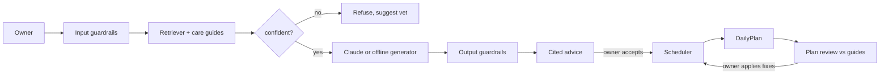

# PawPal+ Care Advisor

PawPal+ plans a pet owner's day of care. It now also has a **retrieval-augmented (RAG) care advisor** that
searches a library of pet-care guides before it suggests tasks, answers questions or reviews a plan.
Every piece of advice cites the guide it came from. When the guides don't cover a question, or the
question is an emergency or asks for a medication dose, the advisor declines and gives a safe response
instead of guessing.

## Base project

This project extends **PawPal+ (Module 2)**. The original was a Streamlit app and Python scheduler for
busy pet owners. It tracked pets and their care tasks (duration, priority, optional set time,
once/daily/weekly), then built a daily plan within the owner's available minutes and day window. It
handled clashing set times and explained why each task was scheduled or skipped. The original planner
had no domain knowledge: it scheduled whatever the owner typed, so a cat with no feeding task or
medication marked "low" priority got no warning.

## What's new in the applied AI version

| Feature | What it does | Where |
|---|---|---|
| Care guide knowledge base | 11 short markdown guides (dogs, cats, small pets, medication, emergencies, routines), each with recommended tasks | `knowledge/` |
| Retriever | BM25 keyword search with a species filter and a confidence score | `pawpal_ai/retriever.py` |
| Task suggestions | Retrieves guides for the pet, then Claude (or offline mode) proposes tasks; the owner ticks which ones to add to the schedule | `CareAdvisor.suggest_tasks` |
| Care questions | Cited answers from the guides; refuses low-confidence, emergency and dosage questions | `CareAdvisor.answer` |
| Plan review | Checks a generated plan against the guides: missing essentials, essentials that got skipped, essentials with too low a priority. The owner can apply the priority fixes and rebuild the plan | `CareAdvisor.review_plan` |
| Guardrails | Input sanitizing; emergency and dose detection; validation of every model suggestion (fields, cited source, no dose amounts, no duplicates); offline fallback when the model fails | `pawpal_ai/guardrails.py` |
| Logging | Every retrieval, model call, rejection and fallback goes to `logs/pawpal.log` | `pawpal_ai/logging_setup.py` |
| Evaluation | 21 question cases, 4 suggestion cases and 7 scripted bad model replies, written to a markdown report | `evaluate.py`, `eval/cases.json` |

The RAG step changes how the app behaves. Retrieved guides decide which tasks get suggested and what
priority and duration they get. The plan review can raise a task's priority, which changes what the
scheduler fits into the day (see Sample 1).

## Architecture overview

Diagram source: [`diagrams/architecture.mmd`](diagrams/architecture.mmd). The class diagrams of the
original scheduler are in `diagrams/uml_initial.mmd` and `diagrams/uml_final.mmd`.



The system has two parts that feed each other:

1. **Scheduler (original):** `Owner`, `Pet`, `Task` and `Scheduler.build_plan` turn tasks into a timed
   `DailyPlan` within the time budget.
2. **Care advisor (new, `pawpal_ai/`):** user text is sanitized and safety-checked first. Emergencies
   and dose requests get a fixed "call your vet" response and never reach the model. Next, the
   retriever ranks the care guides for the pet's species. If the best match covers less than half of
   the question (an IDF-weighted share of the question's words), the advisor declines. Otherwise
   Claude generates from **only** the retrieved sources, or, with no API key, an offline generator
   builds the answer straight from them. Output guardrails check every suggestion and answer. If the
   model output fails them, the advisor falls back to offline mode, so the owner still gets cited help.

A person checks the AI's output at two points: the owner picks which suggestions to add, and the owner
decides whether to apply the plan review's priority fixes. The advisor never edits tasks on its own.
On the testing side, `pytest` checks the logic with a fake model, and `evaluate.py` measures retrieval
and guardrails.

## Setup

Requires Python 3.10+.

```bash
git clone https://github.com/<your-username>/applied-ai-system-final.git
cd applied-ai-system-final
python -m venv .venv
source .venv/bin/activate          # Windows: .venv\Scripts\activate
pip install -r requirements.txt
```

**Optional: use Claude.** Without a key everything runs in offline mode: the same retrieval and
guardrails, with answers taken straight from the guides.

```bash
export ANTHROPIC_API_KEY="sk-ant-..."          # PowerShell: $env:ANTHROPIC_API_KEY="sk-ant-..."
export PAWPAL_MODEL="claude-haiku-5-5"         # optional; this is the default
```

Run it:

```bash
streamlit run app.py              # the app; the advisor is section 4, plan review is under section 5
python advisor_demo.py            # terminal walkthrough of the advisor (add --live to use Claude)
python main.py                    # original scheduler demo
python -m pytest                  # 88 tests
python evaluate.py                # writes assets/eval_results.md (add --live to evaluate Claude)
```

## Sample interactions

All three come from `python advisor_demo.py --date 2026-11-23` in offline mode. The full output is in
[`assets/advisor_demo_output.txt`](assets/advisor_demo_output.txt), and the log of that run is in
[`assets/sample_log.txt`](assets/sample_log.txt).

**Sample 1: the plan review changes the schedule.** The owner has 50 minutes. Luna's meds were entered
as "low" priority, so the original scheduler dropped them:

```
=== 1. Plan as the owner entered it ===
Daily plan for 2026-11-23:
  07:00-07:10 - Feed Luna (Luna, 10 min) [priority: medium]
  07:10-07:20 - Play session (Luna, 10 min) [priority: medium]
  08:00-08:30 - Morning walk (Mochi, 30 min) [priority: high]
  SKIPPED Fetch in the yard (Mochi): needs 20 min but only 0 min of your time is left
  SKIPPED Meds (Luna): needs 10 min but only 0 min of your time is left

=== 2. Care guide review (retrieved rules checked against the plan) ===
  [missing] Mochi: No task covers 'breakfast' for Mochi; the care guide lists it as essential daily care. [dog-feeding]
  [missing] Luna: No task covers 'scoop litter box' for Luna; the care guide lists it as essential daily care. [cat-litter]
  [priority] Luna: 'Meds' is low priority, but the care guide treats this kind of care as high priority. [medication]
  [priority] Luna: 'Feed Luna' is medium priority, but the care guide treats this kind of care as high priority. [cat-feeding-water]

=== 3. Owner accepts the priority fixes; plan is rebuilt ===
  changed Luna: 'Meds' low -> high [medication]
  changed Luna: 'Feed Luna' medium -> high [cat-feeding-water]
Daily plan for 2026-11-23:
  07:00-07:10 - Feed Luna (Luna, 10 min) [priority: high]
  08:00-08:10 - Meds (Luna, 10 min) [priority: high]
  08:10-08:40 - Morning walk (Mochi, 30 min) [priority: high]
      why: high priority, recurs daily; moved from 08:00 to 08:10 because 'Meds' already had that time
  SKIPPED Play session (Luna): needs 10 min but only 0 min of your time is left
  SKIPPED Fetch in the yard (Mochi): needs 20 min but only 0 min of your time is left
```

(Some lines are trimmed here; the full output is in the file.)

**Sample 2: grounded task suggestions.** Mochi already has a morning walk, so the advisor suggests the
care the guides recommend that is still missing:

```
Suggestions for Mochi (mode: offline, confidence 0.61, sources: routine-planning, dog-exercise, dog-feeding, dog-grooming-dental)
  + Breakfast - 10 min, high, daily, 07:30 [dog-feeding]
  + Dinner - 10 min, high, daily, 18:30 [dog-feeding]
  + Refresh water bowl - 5 min, high, daily, flexible [dog-feeding]
  + Evening walk - 30 min, medium, daily, 18:00 [dog-exercise]
  + Brush teeth - 5 min, medium, daily, flexible [dog-grooming-dental]
  + Brush coat - 15 min, low, weekly, flexible [dog-grooming-dental]
```

**Sample 3: questions, including the ones it refuses.**

```
Q: Can I use human toothpaste on my dog?
A: Use toothpaste made for dogs, never human toothpaste, because some contain xylitol, which is toxic to dogs. [dog-grooming-dental] Common household toxins include chocolate, grapes and raisins, xylitol (in some gum and toothpaste), onions and garlic, lilies (for cats), and many human medicines. [emergencies]
   (mode: offline, confidence 1.00, sources: dog-grooming-dental, emergencies)

Q: How much Benadryl can I give my dog?
A REFUSED (dosage): PawPal+ won't suggest medication doses. The right amount depends on your pet's weight, health and the exact product, so please ask your vet or pharmacist. Never give human medicine to a pet without your vet's OK. I can help you schedule medication at a fixed time once you know the dose.
   (mode: guardrail, confidence 1.00, sources: medication)

Q: My dog just ate a bar of chocolate
A REFUSED (emergency): This sounds like it could be an emergency. Call your vet or the nearest 24-hour emergency animal hospital now. If your pet may have eaten something toxic, contact an animal poison control line. PawPal+ can't assess emergencies.
   (mode: guardrail, confidence 1.00, sources: emergencies)

Q: What should I feed my parrot?
A REFUSED (low_confidence): I don't have a care guide that covers this well enough to answer (I don't know: parrot). Please ask your vet.
   (mode: guardrail, confidence 0.28, sources: small-pets)
```

## Design decisions

- **Retrieval before generation, and the model only sees retrieved sources.** Pet care is a domain where
  a confident wrong answer can hurt an animal, so the advisor must be able to point to where every
  suggestion came from. Guardrails reject any model suggestion that cites a source it wasn't given.
- **BM25 instead of embeddings.** With 11 short documents, keyword search was 100% accurate on the
  evaluation set (hit@1), and it needs no extra dependency, no second API and no vector store. The
  trade-off is that it doesn't understand synonyms (see Testing summary). Swapping in embeddings later
  only means replacing `Retriever.search`.
- **A confidence threshold that refuses.** Confidence is the IDF-weighted share of the question's words
  found in the top document. A word the guides have never seen counts as the rarest word, so "parrot"
  pulls confidence down. Below 0.5 the advisor declines. That makes it cautious: it sometimes refuses
  questions it could have answered, which I preferred to having it answer questions it can't.
- **Safety checks run before retrieval and before the model.** Emergency and dose questions get a fixed,
  reviewed response. That behavior is deterministic and testable, and doesn't depend on the model following
  instructions.
- **Offline mode is a full mode, not a stub.** Without a key, or when Claude fails or returns invalid
  output, suggestions come straight from the guides' task lists and answers are extracted from guide
  sentences. The app never stops working because of the AI, and the tests and evaluation are reproducible.
- **The human stays in charge of the schedule.** Suggestions and priority fixes are proposals. Nothing
  changes until the owner ticks a box or clicks "apply".
- **The knowledge base is plain markdown.** It is easy to read, review and extend. Each guide's
  `## Tasks` lines give structured data the planner can use directly (duration, priority, frequency,
  set time) and keys for matching against the owner's own task names.

## Testing summary

- **88 of 88 automated tests pass.** That is the 28 original scheduler tests plus 60 new ones in
  `tests/test_advisor.py`. They use a fake model to check: valid model output is used; hallucinated
  sources, dose amounts, out-of-range durations and duplicates are rejected; non-JSON replies and API
  errors fall back to offline mode; emergency, dosage and off-topic questions never reach the model;
  and applying the plan review's fixes changes the schedule. Output: [`assets/test_output.txt`](assets/test_output.txt).
- **Evaluation (`python evaluate.py`, offline),** full table in [`assets/eval_results.md`](assets/eval_results.md):
  - Question outcomes: 20/21 correct (answered, or refused for the right reason).
  - Retrieval: 14/14 hit@1 on questions with a known source document.
  - Citations: 13/13 answers cite only retrieved sources.
  - Suggestion cases: 4/4. The right tasks are suggested, covered tasks are skipped, and no medication
    task is invented.
  - Guardrail stress test: 7/7 bad model replies blocked, and the owner still got cited help each time.
- **What didn't work:** Q11 ("I'm too busy today, which care should I prioritize?") was refused at
  confidence 0.29. Retrieval found the right guide, but "prioritize" and "today" aren't words the guides
  use (they say "priority"), so the confidence score was too low. Keyword retrieval doesn't handle
  synonyms; embeddings or a synonym list would fix it. Q15 (a missed heartworm dose) is refused by the
  dosage rule even though the guide has safe advice ("call your vet, don't double the dose"). It counts
  as expected behavior, but it's over-cautious.
- **Bugs that testing caught and I fixed:** the emergency check missed "my dog just ate *a bar of*
  chocolate" (the pattern only allowed one word between "ate" and the food). One "Feeding" task was
  hiding both the Breakfast and Dinner suggestions; existing tasks now cover only one care item each.
  "Bathe" and "boredom" didn't match the guides' wording. Stopwords were checked before stemming, so
  "getting" slipped through as "get".
- **Not tested here:** live Claude output. The development environment had no API access, so Claude
  mode is covered by the fake-model tests and the guardrails, but not by a live run. Run
  `python evaluate.py --live` with your key to produce that report. The Streamlit UI was exercised with
  a scripted stand-in for Streamlit (suggest, add, ask, generate, apply fixes), not a real browser
  session.

## Reflection

The biggest lesson was that most of the work in an applied AI system isn't the model call. It's what
surrounds it: deciding what the model is allowed to see, checking what comes back, and having a sensible
answer when either step fails. Building the offline mode first made this clear. Once the system could
give good, cited help with no model at all, the model became an improvement to the wording rather than
something everything depended on. The evaluation set also changed how I think about "done". The demo
looked right long before the eval cases exposed the chocolate bug and the synonym problem. The
responsible-AI reflection, limitations and AI-collaboration notes are in [`model_card.md`](model_card.md).

## Repository map

```
app.py                Streamlit UI (owner, pets, tasks, care advisor, schedule + review)
pawpal_system.py      Scheduler (Module 2)
pawpal_ai/            Care advisor: knowledge.py, retriever.py, guardrails.py, llm.py, advisor.py
knowledge/            Care guides the advisor retrieves from
advisor_demo.py       Terminal walkthrough of the advisor
main.py               Original scheduler demo
evaluate.py           Evaluation harness; cases in eval/cases.json
tests/                pytest suites (scheduler + advisor)
diagrams/             architecture.mmd (system), uml_initial.mmd / uml_final.mmd (classes)
assets/               Captured outputs: demo, tests, evaluation report, sample log
model_card.md         Model card and responsible-AI reflection
reflection.md         Original Module 2 reflection
```

**Video walkthrough** *(optional)*: <!-- add Loom link here -->
